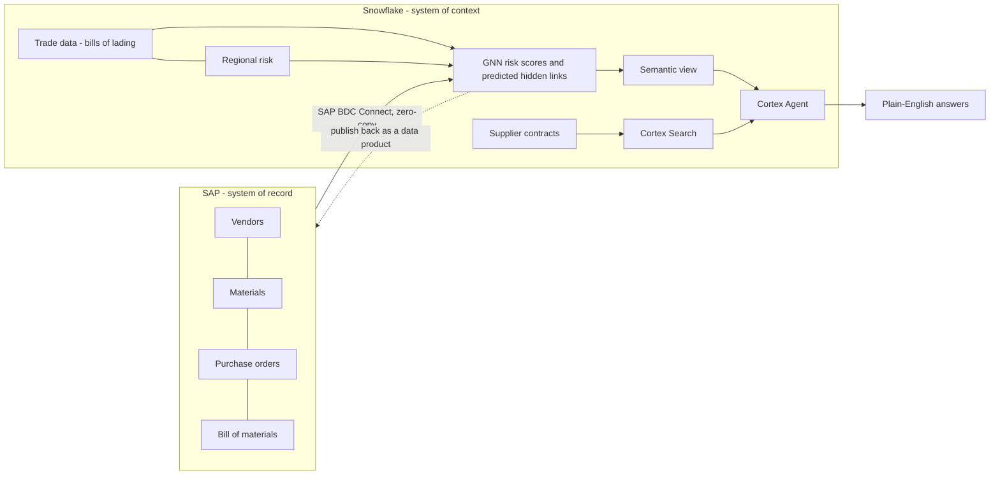

# Find the supplier risk your ERP can't see

### SAP data + a graph neural network + a Cortex Agent, on Snowflake, in about 30 minutes

> [!CAUTION]
> **Disclaimer: synthetic data, for demonstration only.** Every record in this lab (SAP vendors, materials,
> purchase orders and bills of material, trade data, regional risk, supplier contracts, GNN risk scores and
> predicted links) is **synthetic** and was created for this demo. Some company names are those of real
> companies (for example Albemarle Corp, BYD Battery, SK On); they're used **for illustration only**. No
> supplier relationship, contract term, risk score or prediction shown here describes a real company or a real
> business relationship, and none should be used for business, investment or procurement decisions.

Your SAP system knows your **Tier 1** suppliers: who you buy from, what you buy and what you pay.
It doesn't know who **your suppliers** buy from. Those hidden Tier 2 and Tier 3 dependencies cause
the surprises: one chemical plant or one graphite mine quietly feeding half your supply base, until it
stops.

In this hands-on lab you'll:
- combine **SAP S/4HANA data products** (vendors, materials, purchase orders, bill of materials) with
  external trade data, regional risk and supplier contracts;
- use a **graph neural network (GNN)** to predict the hidden supplier links and score every supplier
  and part for risk;
- put all of it behind a **Cortex Agent** that answers questions in plain English, such as:

> *"Which suppliers are CRITICAL risk?"*
> *"What do their contracts say about force majeure?"*

The agent writes the SQL against your SAP data, searches the contract documents, and combines the two into
one answer you can trace back to every query and every passage it used.

**Why it's worth an hour of your time:**
- **It's the SAP Business Data Cloud (BDC) + Snowflake pattern, end to end.** SAP data used *in place*,
  enriched with non-SAP data and AI, with a path for the results to flow back to SAP.
- **It's real AI, not a slide.** Graph ML finds relationships that aren't in any table. Cortex Search
  reads unstructured contracts. A semantic view gives the agent trusted business definitions.
- **It's yours to keep.** Everything runs in your own Snowflake account, built from this repo, and you
  can remove it with one script.
- **You only need a browser.** No installs, no CLI, no GitHub account. Even a Snowflake trial account works.

**Contents:** [Business value](#the-business-value-system-of-record--system-of-context) ·
[What you'll build](#what-youll-build) · [Real vs simulated](#sap-business-data-cloud-whats-real-and-whats-simulated) ·
[Setup](#setup-browser-only-about-30-minutes) · [Labs](#the-labs) · [Clean up](#clean-up) ·
[Quick help](#quick-help) · [For trainers](#for-trainers)

---

## The business value: system of record + system of context

Every supply chain decision needs two kinds of knowledge. Most companies keep them in different places, owned by
different teams, and join them by hand in spreadsheets.

| | **SAP: the system of record** | **Snowflake: the system of context** |
| --- | --- | --- |
| Answers | *What did we commit to?* | *What does it mean, and what's about to happen?* |
| Holds | Vendors, materials, purchase orders, bills of material: the governed transactions the business runs on | Everything around those transactions: trade flows, regional risk, contracts and documents, ML predictions, AI |
| Strength | Accurate, auditable, process-integrated | Any data, any scale, AI next to the data |
| Blind spot | Sees only your direct (Tier 1) suppliers. Can't read a contract or predict a link that isn't in a table | Without SAP, has no ground truth about what the business actually buys |

**SAP BDC Connect is the bridge.** SAP Business Data Cloud publishes SAP data as governed **data products**, and
SAP BDC Connect shares them with Snowflake **zero-copy**: Snowflake queries the SAP data products where they are,
with SAP's business semantics intact. No extract jobs, no second copy drifting out of date. The bridge works in
both directions: insights built in Snowflake can be published back to SAP BDC as data products, so they reach
SAP users and processes.

**What the combination makes possible, in this lab:**

| Without the bridge | With SAP + Snowflake + SAP BDC Connect |
| --- | --- |
| Tier 2/3 dependencies are invisible until a shipment fails | A GNN learns from SAP purchasing plus external trade data and **predicts the hidden links**, for example *Queensland Minerals → BYD Battery* |
| Risk is reviewed per supplier, from memory | Every SAP vendor and material gets a **risk score**, with critical ones flagged |
| The contract question goes to Legal and takes a week | One question to an agent returns the **risk numbers and the contract clauses** together, with sources |
| Insights stay in a data science notebook | Predicted links can be **published back to SAP BDC** as a data product (`publish_to_BDC.ipynb`) |
| Answers can't be checked | Every answer can be audited: the SQL it ran, whether it used **verified** SQL, and the passages it read |

SAP stays the trusted record. Snowflake adds the context and intelligence around it. SAP BDC Connect keeps the two
in sync without copying data. That's the pattern you'll build here, at lab scale.

---

## What you'll build



| Layer | Objects in your account |
| --- | --- |
| SAP data products | 4 databases `S4_Z*_DP_DELTA_SHARING_V1` (vendors 50, materials 26, purchase orders 120, BOM 23) |
| Demo schema | `DEMO_19865_DB.GNN_SUPPLY_CHAIN_RISK`: trade data, regions, contracts, and the GNN outputs (risk scores, predicted links, bottlenecks) |
| Analytics | 4 views: supplier risk, material risk, hidden dependencies, risk summary |
| AI | Cortex Search over contracts, semantic view `SUPPLY_CHAIN_RISK_SEMANTIC_VIEW`, agent `GNN_SUPPLY_RISK_AGENT` |
| Workspace | Your own Git workspace with the GNN notebook, the lab files and the setup scripts |

---

## SAP Business Data Cloud: what's real and what's simulated

The original demo runs on **SAP BDC with Snowflake zero-copy sharing**. Here's how the training
version differs, so you know what you're looking at.

| | Original demo | This training lab |
| --- | --- | --- |
| SAP data | **Live** SAP BDC data products, shared zero-copy into Snowflake as *catalog-linked databases* (Iceberg tables, no data movement) | A **snapshot** of the same data products, loaded as ordinary Snowflake tables |
| Names | `S4_ZVENDORINFO_DP_DELTA_SHARING_V1."s4_zvendorinfo_dp_srv:v1"."s4custom_vendors"`, and so on | **Exactly the same** database, schema and table names |
| Connector needed | An SAP BDC tenant and SAP BDC Connect | None: works in any Snowflake account, including trials |
| Data content | Your company's real SAP data | **Synthetic demo data** (see the disclaimer at the top). Same structure as real SAP data products, invented values |
| Freshness | Updates as SAP changes | Fixed at the time of extraction (2026-11) |
| Writing back to SAP | `publish_to_BDC.ipynb` shares the GNN's predicted links back to SAP BDC as a data product | The notebook is included **for reading only**. It needs a BDC connection to run |

**Why this matters:** because the names are identical, every view, the semantic view and the agent are
**the same code that runs on live SAP BDC**. To move from this lab to a real deployment, replace the 4
snapshot databases with the catalog-linked databases from SAP BDC Connect. Nothing downstream changes.

Things to remember during the labs:
- The SAP schema and table names are **lowercase and quoted** (for example `"s4custom_vendors"`), as SAP
  BDC publishes them. Leave out the quotes and Snowflake won't find them.
- Vendor IDs (for example `V10001`) and material IDs are SAP keys. The GNN results join back to SAP on them.
- The SAP data is read-only in the original. Treat it that way here: the labs only read from it.

---

## Setup (browser only, about 30 minutes)

**You need:**
- a Snowflake account where you can use the **ACCOUNTADMIN** role (a new or trial account is fine);
- a region with Cortex AI.

You **don't** need a GitHub account, Git, or any downloads. Snowflake reads this course straight from GitHub:

| What you might expect | What actually happens |
| --- | --- |
| "Clone the repository to my laptop" | **Not needed.** Step 1 tells Snowflake where the course is, and Snowflake fetches it itself |
| "Download the files and upload them" | **Not needed.** Step 2 shows every course file inside Snowsight |
| "Sign in to GitHub" | **Not needed.** The course repository is public |

### Setup at a glance

| Step | Run | You should see |
| --- | --- | --- |
| [1. Connect to the repo](#step-1---connect-your-account-to-the-course-repository-once-copy-and-paste) | Paste `00_bootstrap.sql` into a new SQL file in **My Workspace** | 4 SAP CSV files listed |
| [2. Git workspace](#step-2---create-your-git-workspace-the-only-new-workspace-you-create) | **+ > Git workspace**, name `gnn_training` | The course folders |
| [3. Account objects](#step-3---account-objects-snowsight01_stage1_accountsql) | `snowsight/01_stage1_account.sql` | All PASS (INFO is fine on trials) |
| [4. SAP data products](#step-4---sap-data-products-snowsight02_stage2_sap_datasql) | `snowsight/02_stage2_sap_data.sql` | 219 SAP rows |
| [5. Demo schema](#step-5---demo-schema-snowsight03_stage3_demo_schemasql) | `snowsight/03_stage3_demo_schema.sql` | 6 tables, 4 views |
| [6. Demo data](#step-6---demo-data-snowsight04_stage4_demo_datasql) | `snowsight/04_stage4_demo_data.sql` | 648 rows |
| [7. Search + semantic view](#step-7---search-and-semantic-view-snowsight05_stage5_search_semantic_viewsql) | `snowsight/05_stage5_search_semantic_view.sql` | Search `ACTIVE/ACTIVE` |
| [8. Agent](#step-8---the-agent-snowsight06_stage6_agentsql) | `snowsight/06_stage6_agent.sql` | Agent names **Albemarle Corp** and **Epsilon Tech** |
| [9. Ready?](#step-9---am-i-ready-snowsight08_readiness_checksql) | `snowsight/08_readiness_check.sql` | **`OVERALL = READY`** |

**Every file is safe to re-run.** If a checkpoint doesn't match, run the same file again.

### Before you start
- Sign in to your Snowflake account in Snowsight.
- Set your role to **ACCOUNTADMIN**: bottom-left, click your name (for example **ALPHATHIA**) > **Switch role** > **ACCOUNTADMIN**.

> **Why the role matters:** Snowsight uses the role in your **user menu** (bottom-left) to decide what you can
> see in dialogs such as *Create Git workspace*. If that role isn't ACCOUNTADMIN, the dialog says
> *"No API integration available"* even after Step 1.

**Do I create a new workspace?** Snowsight has two buttons that look alike. Here's which one to use, and when:

| Step | Create a new workspace? | Button to click | Choose |
| --- | --- | --- | --- |
| **Step 1** (paste one script) | **No.** Use the **My Workspace** that's already there | **+ Add new** (grey button above the file list) | **SQL File** |
| **Step 2** (get the course files) | **Yes, exactly one** | **+** (small plus next to the *Workspaces / Databases* tabs) | **Git workspace** |
| Steps 3 onward | **No.** Use the `gnn_training` workspace from Step 2 | none, just open the files | |

- **Don't** choose *Private workspace* or *Shared workspace* at any point; the course doesn't use them.
- The `demo.ipynb` file you may see in My Workspace is Snowflake's own sample. Ignore it.
- If a Snowflake banner or pop-up appears (for example *"Your legacy worksheets have been moved"* or
  *Automations*), close it with **x** or **Close**. It doesn't affect the course.

### Step 1 - Connect your account to the course repository (once, copy and paste)

The only step where you copy code by hand. **Don't create a new workspace for this step.**

> **You'll use two browser tabs:** one shows the code (Tab A), and Snowsight is where you paste and run it (Tab B).

**In Snowsight: open an empty SQL file**
1. In the left navigation, click **Workspaces**.
2. Check that the selector at the top of the file list says **My Workspace**. If it shows another name, click
   it and choose **My Workspace**.
3. Click the grey **+ Add new** button (just above the file list), then **SQL File**. Name it `bootstrap.sql`
   and press Enter. An empty editor tab opens.

**In a new browser tab: copy the code**

4. Open this address in a new browser tab (click it, or paste it into the address bar):

   **https://raw.githubusercontent.com/snowflakethia/sap_ws_202611/main/snowsight/00_bootstrap.sql**

   The page shows only the code, as plain text. Its first line starts with `-- ====`.
   Click anywhere on the text, press **Ctrl + A** (Mac: **Cmd + A**) to select all, then **Ctrl + C**
   (Mac: **Cmd + C**) to copy.

   *Page doesn't open, or your company network blocks it?* Use [Appendix A](#appendix-a---other-ways-to-copy-the-step-1-code).

**Back in Snowsight: paste and run**

5. Click inside the empty `bootstrap.sql` editor and paste: **Ctrl + V** (Mac: **Cmd + V**). You should see about
   45 lines, starting with `-- ====`.
6. At the top of the editor, click **Choose role** and select **ACCOUNTADMIN**. Leave **Choose warehouse** empty.
7. Click the small **arrow next to Run** > **Run All** (or press Ctrl/Cmd + Shift + Enter).
   Don't select any lines first; Run All runs everything.

**Checkpoint 1 - you should see:** in the results pane at the bottom, a table with **4 rows**, ending in
`s4custom_billofmaterials.csv`, `s4custom_materials.csv`, `s4custom_purchase_orders.csv` and `s4custom_vendors.csv`.

| If you see | Do this |
| --- | --- |
| `Insufficient privileges to operate on account` | Your role isn't ACCOUNTADMIN. Switch the role in the context bar and run again |
| `Repository ... not found` / `403` | Check your internet access; don't change the code |
| Only part of the code ran | You selected some lines before running. Click inside the editor, then use **Run All** |

### Step 2 - Create your Git workspace (the only new workspace you create)

This gives you every course file inside Snowsight, so you never copy code again.

1. Check your **user-menu** role (bottom-left, under your name) is **ACCOUNTADMIN**. If not: click your name >
   **Switch role** > **ACCOUNTADMIN**.
2. In the file panel, find the **Workspaces | Databases** tabs. Click the small **+** to the right of them.
   (Not the grey *+ Add new* button; that one adds files.)
3. Under **Create new**, click **Git workspace**. Don't choose *Private workspace* or *Shared workspace*.
4. Fill in the dialog exactly:

   | Field | Enter |
   | --- | --- |
   | Repository URL | `https://github.com/snowflakethia/sap_ws_202611.git` |
   | Workspace name | `gnn_training` (replace the suggested `sap_ws_202611`) |
   | API integration | `GNN_KIT_GITHUB` (pick it from the list) |
   | Authentication | **Public repository** |

5. Click **Create**. After a few seconds the new workspace opens, with the course folders on the left.

**Checkpoint 2 - you should see:**
- The selector at the top of the file list says **gnn_training**.
- The folders `config`, `data`, `docs`, `labs`, `scripts`, `snowsight`, `sql` and `workspace`, plus `README.md`.

| If you see | Do this |
| --- | --- |
| **No API integration available** | Click **Cancel**. Do Step 1 first, then switch your **user-menu** role to ACCOUNTADMIN and open the dialog again |
| `GNN_KIT_GITHUB` isn't in the list | Same as above: Step 1 hasn't run, or your user-menu role isn't ACCOUNTADMIN |
| I created a *Private* or *Shared* workspace by mistake | Harmless. Ignore it, or delete it from the workspace selector's **...** menu, then do Step 2 again with **Git workspace** |
| I can't find the small **+** | Hover just right of the *Workspaces / Databases* tabs at the top of the file panel. If the panel is collapsed, click **Workspaces** in the left navigation first |
| No **Git workspace** option | Your account uses the older Worksheets UI. Use **Catalog > Database Explorer > TRAINING_KIT_REPO > PUBLIC > Git Repositories > GNN_KIT**, find each file and choose **Copy into worksheet** |

You can delete `bootstrap.sql` from **My Workspace** now. You don't need it again.

> **Switching between workspaces:** the selector at the top of the file list switches between **My Workspace**
> and **gnn_training**. From now on, always make sure it says **gnn_training**.

### How to run every remaining file

For Steps 3-9, repeat these five actions:

1. Make sure the selector at the top of the file list says **gnn_training**.
2. Click the **snowsight** folder to open it, then click the file (for example `01_stage1_account.sql`).
   It opens in an editor tab.
3. At the top of the editor, click **Choose role** > **ACCOUNTADMIN**. Leave the warehouse empty; the scripts
   set their own.
4. Click the **arrow next to Run** > **Run All**. Wait until it finishes; a spinner shows while it runs.
5. In the results pane at the bottom, look at the **last result** and compare it with the checkpoint below.
   Every row in the **RESULT** column must read **PASS**. **INFO** is fine where noted.

### Step 3 - Account objects: `snowsight/01_stage1_account.sql`
Creates the course role, warehouse, compute pool and project database, and enables **Cortex cross-region
inference** so CoCo, Cortex Agents and Cortex Analyst can route to a region with the required models. About 1 minute.

**Checkpoint 3**

| CHECK_NAME | ACTUAL | RESULT |
| --- | --- | --- |
| S1-A role DEMO_19865_ROLE exists | `1` | PASS |
| S1-A warehouse size/auto_suspend/owner | `SMALL/300/DEMO_19865_ROLE` | PASS |
| S1-A compute pool family/nodes | `CPU_X64_M/1-1` | PASS |
| S1-B integrations | `DEMO_19865_PIP_INSTALLATION:true`, or `none` | PASS, or **INFO** on a trial account (that's expected) |
| S1-C key grants to DEMO_19865_ROLE | `4`, or `3` on a trial account | PASS |
| S1-D Cortex cross-region inference (CoCo, agents) | `ANY_REGION` | PASS |

### Step 4 - SAP data products: `snowsight/02_stage2_sap_data.sql`
Creates the 4 SAP data product databases and loads them. About 1 minute.

**Checkpoint 4:** every row PASS.
- `S2-A 4 SAP snapshot databases, kind STANDARD` = `4/4`
- Rows: vendors `50`, materials `26`, purchase_orders `120`, billofmaterials `23`, TOTAL `219`
- `S2-C vendor columns populated` = `50/50/50/50`

### Step 5 - Demo schema: `snowsight/03_stage3_demo_schema.sql`
Creates the demo tables, views and stages. Under 1 minute.

**Checkpoint 5:** every row PASS.
- `6 tables, iceberg=0`
- views `4`
- `compiled and ran`
- stages + file format `3 + 1`
- `DEMO_SECRETS_STAGE is empty` = `0`

### Step 6 - Demo data: `snowsight/04_stage4_demo_data.sql`
Loads the trade data, contracts and precomputed GNN results. About 1 minute.

**Checkpoint 6:** every row PASS.
- Rows: BOTTLENECKS `10`, CUSTOMER_CONTRACTS `12`, REGIONS `9`, RISK_SCORES `86`, SUPPLIER_LINKS `381`,
  TRADE `150`, TOTAL `648`
- `VW_RISK_SUMMARY SUPPLIERS` = `50/2/4/0.4060`, `PARTS` = `26/0/0/0.4768`
- `VW_SUPPLIER_RISK` `50`, `VW_MATERIAL_RISK` `26`, `VW_HIDDEN_DEPENDENCIES` `26`, EMBEDDING = `ARRAY`

### Step 7 - Search and semantic view: `snowsight/05_stage5_search_semantic_view.sql`
Builds the contract search index and the semantic view. 1-6 minutes, because it waits for the index.

**Checkpoint 7:** every row PASS.
- Search service = `CONTRACT_TEXT ACTIVE/ACTIVE`
- Semantic view exists = `1`
- Search "force majeure" = `3 results, first=SC-...`
- Semantic view structure = `4 tables, 9 facts, 26 dimensions`
- Semantic view query = `50 rows: CRITICAL 2, HIGH 4, MEDIUM 44`

If the search row says **WAIT**, wait a minute and run the file again.

### Step 8 - The agent: `snowsight/06_stage6_agent.sql`
Creates the Cortex Agent. Under 1 minute.

**Checkpoint 8a:** every row PASS.
- `1:GNN_SUPPLY_RISK_AGENT`
- tools `supply_chain_risk_analyst,contract_search`
- instructions `true/true`

**Checkpoint 8b (in the UI):**
1. In the left navigation, hover over **AI** > **Agent Studio**. On the **Agents** tab, click
   **GNN_SUPPLY_RISK_AGENT**, then click the **Preview** tab.
2. Ask: **Which suppliers are CRITICAL risk?**
3. You should see **Albemarle Corp** and **Epsilon Tech** (both AUS, GNN risk score about 0.61).

### Step 9 - Am I ready? `snowsight/08_readiness_check.sql`
Read-only; you can run it at any time.

**Checkpoint 9:**
- The first row reads **`OVERALL | READY | PASS - you can start the labs`**.
- Then 9 PASS rows (including **Cortex cross-region inference = ANY_REGION**, which lets CoCo and the agent use a
  region with the required models), and 2 INFO rows: the optional Lab 5 dashboard and the workspace you checked in Step 2.

If it says **NOT READY**, look at the first FAIL row and run the file named in its **FIX** column.
Then run Step 9 again.

**You're ready. Start with [Lab 1](labs/lab1_explore_data.md).**

---

## The labs

| Lab | Time | What you'll learn |
| --- | --- | --- |
| [1. Explore the data](labs/lab1_explore_data.md) | 15 min | Query the SAP data products alongside the external signals, and read the GNN's risk scores and predicted hidden links. Why are the 2 CRITICAL suppliers both in Australia? |
| [2. Ask the agent](labs/lab2_ask_the_agent.md) | 25 min | Ask 5 questions, then open the agent's **traces** to see the SQL it ran, whether it used verified SQL, and the contract passages it read. Run the agent's contract search yourself |
| [3. Build your own agent](labs/lab3_build_your_own_agent.md) | 20 min | Build an agent from scratch in Agent Studio, then compare it with the tuned one to see what orchestration instructions add |
| [4. Retrain the GNN](labs/lab4_optional_retrain_gnn.md) (optional) | 45-60 min | Run the PyTorch Geometric notebook on Snowpark Container Services and produce your own risk scores. *Needs a non-trial account (internet access for Python packages)* |
| [5. Build a dashboard with one prompt](labs/lab5_dashboard_with_coco.md) (optional) | 45-60 min | One prompt to **Cortex Code (CoCo)** builds a 7-page Streamlit dashboard over 5 databases: spend at risk, hidden Tier 2 bottlenecks, BOM exposure, contract search, plus business and technical architecture pages. Use the pattern for design-thinking prototypes |

---

## Clean up

When the course is over:
1. In **gnn_training**, open `snowsight/99_remove_setup.sql`, set role **ACCOUNTADMIN**, then **Run All**.
   Expected: **6 rows**, every RESULT = **REMOVED**.
2. Delete the workspace: **Workspaces** (left navigation), open the workspace selector, click **...** next to
   **gnn_training** > **Delete**.

Only what this lab created is removed.

---

## Quick help

| Problem | Fix |
| --- | --- |
| *No API integration available* when creating the workspace | Run Step 1, then set your **user-menu** role (bottom-left) to ACCOUNTADMIN |
| `Git repository ... does not exist` | Step 1 hasn't been run in this account |
| `Insufficient privileges` / `does not exist or not authorized` | Set the role in the editor's context bar to **ACCOUNTADMIN** |
| A row says FAIL | Run the same file again. If it still fails, re-run the previous step, then this one |
| The agent says it has no access | Switch your user-menu role to ACCOUNTADMIN and ask again |
| Anything else | Run Step 9 and show the result to your trainer |

More: [docs/TROUBLESHOOTING.md](docs/TROUBLESHOOTING.md).

---

## For trainers

| Need | Where |
| --- | --- |
| Deploy to many accounts from a terminal (Snowflake CLI) | [docs/SETUP_GUIDE.md](docs/SETUP_GUIDE.md): `bash scripts/deploy.sh -c <connection>` |
| What was copied from the source demo, and what changed | [docs/SOURCE_INVENTORY.md](docs/SOURCE_INVENTORY.md) |
| Troubleshooting | [docs/TROUBLESHOOTING.md](docs/TROUBLESHOOTING.md) |

<details>
<summary>Repository layout</summary>

| Folder | Contents |
| --- | --- |
| `snowsight/` | The setup files to run in Snowsight, readiness check, removal script, Lab 5 fallback deploy (`07_lab5_dashboard.sql`) |
| `sql/` | Deployment and validation SQL, shared by the Snowsight and CLI paths |
| `data/` | CSV snapshots of the SAP data products and demo tables, plus `manifest.csv` (row counts and checksums) |
| `workspace/` | The GNN notebook, the SAP BDC publish notebook, and reference SQL |
| `labs/` | **All 5 lab guides** (one set for every trainee), the Lab 3 SQL solution and the Lab 5 reference app (`labs/lab5_app/`) |
| `scripts/`, `config/` | CLI deployment scripts and defaults |
| `docs/` | Trainer guides |

</details>

---

## Appendix A - Other ways to copy the Step 1 code

**You only need this if the plain-text page in Step 1 won't open.** That usually means a company network or
browser policy blocks `raw.githubusercontent.com`. Use **one** of these methods, then continue with Step 1, action 5.

### A1 - GitHub file page (when the plain-text page is blocked)
1. Open **https://github.com/snowflakethia/sap_ws_202611/blob/main/snowsight/00_bootstrap.sql**
2. Above the code, on the right of the grey bar that shows the file size, click the **Copy raw file** button
   (two overlapping squares). It briefly shows a tick.
3. **Don't** use Ctrl + A on this page. That selects the whole web page (menus, line numbers), not just the code.

### A2 - Copy from this page (when GitHub file pages are blocked too)
Hover over the grey box below. A **copy** button (two overlapping squares) appears in its top-right corner;
click it. If no button appears (for example on a tablet), drag to select the whole box, then press Ctrl/Cmd + C.

```sql
-- GNN Supply Chain Risk training - Step 1: connect this account to the course on GitHub
-- (same as snowsight/00_bootstrap.sql)
USE ROLE ACCOUNTADMIN;

CREATE OR REPLACE API INTEGRATION GNN_KIT_GITHUB
    API_PROVIDER = git_https_api
    API_ALLOWED_PREFIXES = ('https://github.com/snowflakethia/')
    ENABLED = TRUE
    COMMENT = 'GNN Supply Chain Risk training - read access to the public GitHub repo';

CREATE DATABASE IF NOT EXISTS TRAINING_KIT_REPO
    COMMENT = 'GNN Supply Chain Risk training - GitHub repo clone and file staging';

CREATE GIT REPOSITORY IF NOT EXISTS TRAINING_KIT_REPO.PUBLIC.GNN_KIT
    API_INTEGRATION = GNN_KIT_GITHUB
    ORIGIN = 'https://github.com/snowflakethia/sap_ws_202611.git'
    COMMENT = 'GNN Supply Chain Risk training kit';

ALTER GIT REPOSITORY TRAINING_KIT_REPO.PUBLIC.GNN_KIT FETCH;

CREATE STAGE IF NOT EXISTS TRAINING_KIT_REPO.PUBLIC.KIT_FILES
    COMMENT = 'Data files copied from the Git repository before loading';

-- CHECKPOINT 1: expect exactly 4 CSV files.
LIST @TRAINING_KIT_REPO.PUBLIC.GNN_KIT/branches/main/data/sap/;
```

These are the same statements as `snowsight/00_bootstrap.sql`, without the explanatory header.
