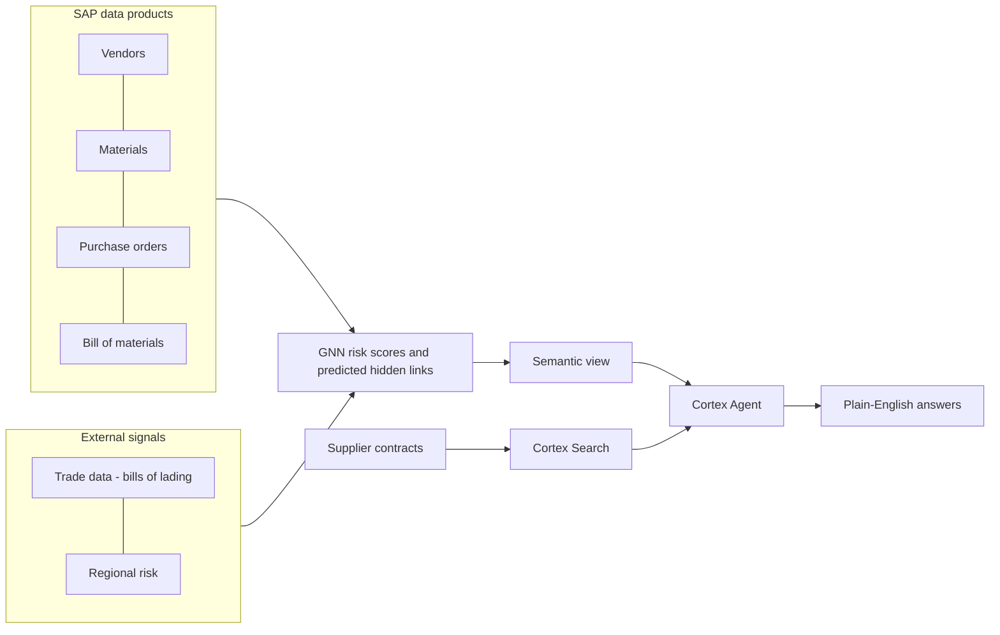

# Find the supplier risk your ERP can't see

### SAP data + a graph neural network + a Cortex Agent, on Snowflake, in about 30 minutes

Your SAP system knows your **Tier 1** suppliers: who you buy from, what you buy and what you pay.
It doesn't know who **your suppliers** buy from. Those hidden Tier 2 and Tier 3 dependencies cause
the surprises: one chemical plant or one graphite mine quietly feeding half your supply base, until it
stops.

In this hands-on lab you'll:
- combine **SAP S/4HANA data products** (vendors, materials, purchase orders, bill of materials) with
  external trade and regional-risk data;
- use a **graph neural network (GNN)** to predict the hidden supplier links and score every supplier
  and part for risk;
- put all of it behind a **Cortex Agent** that answers questions in plain English, such as:

> *"Which suppliers are CRITICAL risk?"*
> *"What do their contracts say about force majeure?"*

The agent writes the SQL against your SAP-shaped data, searches the contract documents, and combines
the two into one answer.

**Why it's worth an hour of your time:**
- **It's the SAP Business Data Cloud (BDC) + Snowflake pattern, end to end.** You see SAP data products
  used *in place*, enriched with non-SAP data and AI, and how the results can flow back to SAP.
- **It's real AI, not a slide.** Graph ML finds relationships that aren't in any table. Cortex Search
  reads unstructured contracts. A semantic view gives the agent trusted business definitions.
- **It's yours to keep.** Everything runs in your own Snowflake account, built from this repo, and you
  can tear it down with one script.
- **You only need a browser.** No installs and no CLI. Even a Snowflake trial account works.

---

## What you'll build

| Layer | Objects in your account |
| --- | --- |
| SAP data products | 4 databases `S4_Z*_DP_DELTA_SHARING_V1` (vendors 50, materials 26, purchase orders 120, BOM 23) |
| Demo schema | `DEMO_19865_DB.GNN_SUPPLY_CHAIN_RISK`: trade data, regions, contracts, and the GNN outputs (risk scores, predicted links, bottlenecks) |
| Analytics | 4 views: supplier risk, material risk, hidden dependencies, risk summary |
| AI | Cortex Search over contracts, semantic view `SUPPLY_CHAIN_RISK_SEMANTIC_VIEW`, agent `GNN_SUPPLY_RISK_AGENT` |
| Workspace | Your own Git workspace with the GNN notebook, the lab files and the setup scripts |

---

## SAP Business Data Cloud: what's real and what's simulated

The original demo runs on **SAP BDC with Snowflake zero-copy sharing**. Here's how the training
version differs, so you know what you're looking at.

| | Original demo | This training lab |
| --- | --- | --- |
| SAP data | **Live** SAP BDC data products, shared zero-copy into Snowflake as *catalog-linked databases* (Iceberg tables, no data movement) | A **snapshot** of the same data products, loaded as ordinary Snowflake tables |
| Names | `S4_ZVENDORINFO_DP_DELTA_SHARING_V1."s4_zvendorinfo_dp_srv:v1"."s4custom_vendors"`, and so on | **Exactly the same** database, schema and table names |
| Connector needed | An SAP BDC tenant and the Snowflake zero-copy connector | None: works in any Snowflake account, including trials |
| Freshness | Updates as SAP changes | Fixed at the time of extraction (2026-11) |
| Writing back to SAP | `publish_to_BDC.ipynb` shares the GNN's predicted links back to SAP BDC as a data product | The notebook is included **for reading only**. It needs a BDC connector to run |

**Why this matters:** because the names are identical, every view, the semantic view and the agent are
**the same code that runs on live SAP BDC**. To move from this lab to a real deployment, replace the 4
snapshot databases with the catalog-linked databases from your SAP BDC connector. Nothing downstream
changes.

Things to remember during the labs:
- The SAP schema and table names are **lowercase and quoted** (for example `"s4custom_vendors"`), as SAP
  BDC publishes them. Leave out the quotes and Snowflake won't find them.
- Vendor IDs (for example `V10001`) and material IDs are SAP keys. The GNN results join back to SAP on them.
- The SAP data is read-only in the original. Treat it that way here: the labs only read from it.

---

## Setup (browser only, about 30 minutes)

> ### Step-by-step guide: **[SETUP.md](SETUP.md)**
> It covers every click, every expected result and the common errors. Use it while you set up.

**You need:**
- a Snowflake account where you can use the **ACCOUNTADMIN** role (a new or trial account is fine);
- a region with Cortex AI.

The full, click-by-click guide with every checkpoint is in **[SETUP.md](SETUP.md)**. In short:

| Step | Do this in Snowsight | You should see |
| --- | --- | --- |
| **0. Connect to this repo** | **Don't create a new workspace.** In **Workspaces** (left navigation), with **My Workspace** selected, click **+ Add new > SQL File**. Paste the code block from [SETUP.md Step 1](SETUP.md#step-1---connect-your-account-to-the-course-repository-once-copy-and-paste), set role **ACCOUNTADMIN**, then **Run All** | 4 SAP CSV files listed |
| **0b. Create your Git workspace** | Set your **user-menu** role (bottom-left) to **ACCOUNTADMIN**. Then, in **Workspaces**, click the small **+** next to the *Workspaces / Databases* tabs > **Git workspace** (not *Private* or *Shared*). Use URL `https://github.com/snowflakethia/sap_ws_202611.git`, name `gnn_training`, API integration `GNN_KIT_GITHUB`, authentication **Public repository** ([details](snowsight/00b_create_git_workspace.md)) | Folders `snowsight/`, `sql/`, `data/`, `labs/`. If you see *No API integration available*, step 0 hasn't run or your role isn't ACCOUNTADMIN |
| **1. Account objects** | In `gnn_training`, open `snowsight/01_stage1_account.sql` and **Run All** | All rows PASS (INFO is fine on trial accounts) |
| **2. SAP data products** | `snowsight/02_stage2_sap_data.sql`, **Run All** | 219 SAP rows, PASS |
| **3. Demo schema** | `snowsight/03_stage3_demo_schema.sql`, **Run All** | 6 tables, 4 views, PASS |
| **4. Demo data** | `snowsight/04_stage4_demo_data.sql`, **Run All** | 648 rows, risk summary `50/2/4/0.4060`, PASS |
| **5. Search + semantic view** | `snowsight/05_stage5_search_semantic_view.sql`, **Run All** (waits for the index) | Search `ACTIVE/ACTIVE`, PASS |
| **6. Agent** | `snowsight/06_stage6_agent.sql`, **Run All**. Then in **AI > Agent Studio**, open **GNN_SUPPLY_RISK_AGENT** and ask *"Which suppliers are CRITICAL risk?"* | PASS, and the answer names **Albemarle Corp** and **Epsilon Tech** |
| **Ready?** | `snowsight/08_readiness_check.sql`, **Run All** | **`OVERALL = READY`** |

**Every file is safe to re-run.** If a checkpoint doesn't match, run the same file again. If the
readiness check says NOT READY, it tells you which file to re-run.

---

## The labs

| Lab | Time | What you'll learn |
| --- | --- | --- |
| [1. Explore the data](snowsight/labs/LAB1_explore_data.md) | 15 min | Query the SAP data products alongside the external signals, and read the GNN's risk scores and predicted hidden links. Why are the 2 CRITICAL suppliers both in Australia? |
| [2. Ask the agent](snowsight/labs/LAB2_ask_the_agent.md) | 20 min | Ask 5 questions and watch the agent choose between **Cortex Analyst** (SQL over the semantic view) and **Cortex Search** (contracts), or use both together |
| [3. Build your own agent](snowsight/labs/LAB3_build_your_own_agent.md) | 20 min | Build an agent from scratch in the Snowsight UI, then compare it with the tuned one to see what orchestration instructions add |
| [4. Retrain the GNN](snowsight/labs/LAB4_optional_retrain_gnn.md) (optional) | 45-60 min | Run the PyTorch Geometric notebook on Snowpark Container Services and produce your own risk scores. *Needs a non-trial account (internet access for Python packages)* |

---

## Clean up

When you're done:
1. Open `snowsight/99_remove_setup.sql` and select **Run All**. Every row should read **REMOVED**.
2. Delete the `gnn_training` workspace: **Workspaces** (left navigation) > workspace selector > **...** next to `gnn_training` > **Delete**.

Only what this lab created is removed.

---

## For trainers

| Need | Where |
| --- | --- |
| Deploy to many accounts from a terminal (Snowflake CLI) | [docs/SETUP_GUIDE.md](docs/SETUP_GUIDE.md): `bash scripts/deploy.sh -c <connection>` |
| What was copied from the source demo, and what changed | [docs/SOURCE_INVENTORY.md](docs/SOURCE_INVENTORY.md) |
| Troubleshooting | [docs/TROUBLESHOOTING.md](docs/TROUBLESHOOTING.md) |

Repository layout

| Folder | Contents |
| --- | --- |
| `snowsight/` | Trainee guide, the setup files to run in Snowsight, readiness check, removal script, labs |
| `sql/` | Deployment and validation SQL, shared by the Snowsight and CLI paths |
| `data/` | CSV snapshots of the SAP data products and demo tables, plus `manifest.csv` (row counts and checksums) |
| `workspace/` | The GNN notebook, the SAP BDC publish notebook, and reference SQL |
| `labs/` | CLI-path lab guides and the lab 3 SQL solution |
| `scripts/`, `config/` | CLI deployment scripts and defaults |
| `docs/` | Trainer guides |

