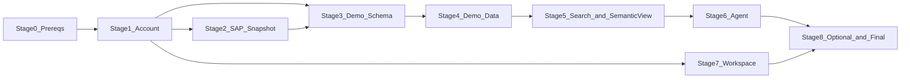

# Setup Guide - GNN Supply Chain Risk Training Environment

> [!CAUTION]
> **Disclaimer:** all data in this lab is **synthetic and for demonstration only**. Company names (for example
> Albemarle Corp, BYD Battery or Queensland Minerals) are used for illustration. The vendors, purchase orders,
> trade records, contracts, risk scores and predicted links are invented and **don't describe any real
> company, relationship or risk**. Don't use them for business decisions.

> **Audience: trainers and administrators using the Snowflake CLI.**
> Trainees who only have Snowsight should follow [`snowsight/README.md`](../snowsight/README.md) instead.
> Both paths run the same `sql/` scripts and give the same result.

This guide rebuilds the **GNN Supply Chain Risk** demo from Snowflake account `F9A3UBGT-DEFAULT`
in a separate trainee account. Each trainee gets their own account and has the ACCOUNTADMIN role.

The setup runs in **9 stages (0-8)**. After each stage, `deploy.sh` stops and you complete a
**3-step human validation**:
- **Check A:** the objects exist.
- **Check B:** the content or behaviour is correct.
- **Check C:** the UI or permissions are correct.

Continue only when all three match the expected outcome.

---

## 1. What you get

| Area | Objects |
| --- | --- |
| Account | Role `DEMO_19865_ROLE`, warehouse `DEMO_19865_WH` (Small), compute pool `DEMO_19865_POOL`, PyPI external access integration |
| SAP data (snapshot) | 4 databases `S4_Z*_DP_DELTA_SHARING_V1` with vendors, materials, purchase orders and bill of materials (219 rows) |
| Demo schema `DEMO_19865_DB.GNN_SUPPLY_CHAIN_RISK` | 6 tables (648 rows, including precomputed GNN outputs), 4 views, 3 stages, `CSV_FORMAT` |
| AI | Cortex Search `CONTRACT_SEARCH_SERVICE`, semantic view `SUPPLY_CHAIN_RISK_SEMANTIC_VIEW`, Cortex Agent `GNN_SUPPLY_RISK_AGENT` |
| Workspace | Shared workspace `DEMO_SHARED_WORKSPACES.DEMO_19865_WORKSPACE.DEMO_19865` with 3 SQL scripts, 2 notebooks and 2 CSVs |
| Optional | Read-only role `DEMO_READER_ROLE` (off by default) |



Differences from F9A3UBGT are listed in [SOURCE_INVENTORY.md](SOURCE_INVENTORY.md).

---

## 2. Prerequisites

| # | Requirement | How to check |
| --- | --- | --- |
| 1 | A Snowflake account for the trainee, with a user that has **ACCOUNTADMIN** | Log in to Snowsight; the role selector shows ACCOUNTADMIN |
| 2 | Region supports **Cortex Agents, Cortex Search and Cortex Analyst** | Snowsight > AI menu shows **Agent Studio** and **Search** |
| 3 | **Snowflake CLI** (`snow`) 3.x on the machine that runs the kit | `snow --version` |
| 4 | **Python 3** (used by `deploy.sh` to read one JSON value) | `python3 --version` |
| 5 | A CLI connection to the trainee account | `snow connection add`, then `snow connection test -c <name>` |
| 6 | This kit folder (`training_kit/`) | `ls training_kit/scripts` shows `deploy.sh` |

SPCS (Snowpark Container Services) compute pools are needed only for optional Lab 4.

> **Never point the kit at F9A3UBGT.** Stage 0 fails if the connection resolves to organization
> `F9A3UBGT`, and `teardown.sh` refuses to run there.

---

## 3. Quick start

```bash
cd training_kit
cp config/config.env.example config/config.env     # optional: set CONNECTION=...
snow connection test -c <trainee-connection>
bash scripts/deploy.sh -c <trainee-connection>     # pauses after every stage
```

Useful variants:

```bash
bash scripts/deploy.sh -c <conn> --from 5                 # resume at stage 5
bash scripts/deploy.sh -c <conn> --stage 4                # re-run one stage
bash scripts/validate.sh -c <conn> --stage 6              # checks only, no changes
bash scripts/deploy.sh -c <conn> --with-reader-role       # include the optional reader role
bash scripts/teardown.sh -c <conn>                        # remove everything
```

Every run is logged to `logs/deploy_<connection>_<timestamp>.log`.

**How to read the automated checks.** Each validation script prints a table with the columns
`CHECK_NAME`, `EXPECTED`, `ACTUAL` and `RESULT`:
- `PASS` means the check matched.
- `INFO` is informational, for example an optional module that is switched off.
- `WAIT` means wait a minute and run `bash scripts/validate.sh -c <conn> --stage N` again.
- `FAIL` means stop and see [TROUBLESHOOTING.md](TROUBLESHOOTING.md).

---

## 4. Stage-by-stage setup and validation

### Stage 0 - Prerequisites
**What it does:** checks the role and the target account. It creates nothing.
**Scripts:** `sql/stage0_prereqs/00_prereqs_check.sql`, `sql/validation/v0_prereqs.sql`

| Check | Action | Expected outcome |
| --- | --- | --- |
| A | `snow --version` and `snow connection test -c <conn>` | CLI version 3.x. The connection test shows **Status: OK** and the trainee account host |
| B | Read rows `S0-A` and `S0-B` in the output | `S0-A` ACTUAL = `ACCOUNTADMIN` -> PASS. `S0-B` ACTUAL shows the trainee's organization, account and region (**not** `F9A3UBGT`) -> PASS |
| C | Read the two `SHOW DATABASES` results at the end | Both return **0 rows** on a new account. If they return rows, the kit was deployed before; re-running is safe |

### Stage 1 - Account objects
**What it does:** creates the role, the warehouse and compute pool, the project database and schema,
the PyPI network rule and external access integration, and the Cortex grant.
**Scripts:** `sql/stage1_account/10_roles.sql`, `11_warehouse_compute_pool.sql`, `12_network_rule_pypi.sql`, `12b_eai_pypi.sql` (best effort), `13_cortex_grants.sql`, then `v1_account.sql`

| Check | Action | Expected outcome |
| --- | --- | --- |
| A | Rows `S1-A` | Role exists = `1`. Warehouse = `SMALL/300/DEMO_19865_ROLE`. Compute pool = `CPU_X64_M/1-1`. All PASS |
| B | Row `S1-B` | Integrations = `DEMO_19865_PIP_INSTALLATION:true` -> PASS. **Trial accounts:** `none` -> `INFO - not created (trial account)`, and deploy prints a `WARNING`. This is expected: trial accounts don't support external access, and only optional Lab 4 needs it |
| C | Row `S1-C`, then in Snowsight go to Admin > Users & Roles > `DEMO_19865_ROLE` | `S1-C` = `4`: USAGE on the PyPI integration, OWNERSHIP of the warehouse and pool, and `SNOWFLAKE.CORTEX_USER`. On a trial account it is `3`, because the integration is absent. Either way -> PASS. In Snowsight the role is granted to `SYSADMIN` and to your user |

### Stage 2 - SAP data product snapshot
**What it does:** creates the 4 SAP databases with their quoted lowercase schemas and tables.
It uploads `data/sap/*.csv` to your user stage and loads them.
**Scripts:** `sql/stage2_sap_snapshot/20_` ... `22_`, then `v2_sap_snapshot.sql`

| Check | Action | Expected outcome |
| --- | --- | --- |
| A | Row `S2-A` | `4/4`: four databases, all kind **STANDARD** (not catalog-linked) -> PASS |
| B | Rows `S2-B` | vendors **50**, materials **26**, purchase_orders **120**, billofmaterials **23**, TOTAL **219**. All PASS |
| C | Row `S2-C`, then in Snowsight go to Data > Databases > `S4_ZVENDORINFO_DP_DELTA_SHARING_V1` > `s4_zvendorinfo_dp_srv:v1` > `s4custom_vendors` > Data Preview | `S2-C` = `50/50/50/50` -> PASS. The preview shows columns VENDOR_ID, NAME, COUNTRY_CODE, CITY, PHONE, TIER and FINANCIAL_HEALTH_SCORE, with values filled in |

### Stage 3 - Demo schema
**What it does:** creates the stages, `CSV_FORMAT`, the 6 tables and the 4 views in
`DEMO_19865_DB.GNN_SUPPLY_CHAIN_RISK`.
**Scripts:** `sql/stage3_demo_schema/30_` ... `33_`, then `v3_demo_schema.sql`

| Check | Action | Expected outcome |
| --- | --- | --- |
| A | Row `S3-A` | `6 tables, iceberg=0`: all standard tables -> PASS |
| B | Rows `S3-B` | Views = `4` -> PASS. `VW_SUPPLIER_RISK resolves SAP snapshot names` = `compiled and ran` -> PASS. An error such as *"Object 'S4_ZVENDORINFO_DP_DELTA_SHARING_V1...' does not exist"* means Stage 2 is incomplete |
| C | Rows `S3-C` | Stages and file format = `3 + 1` -> PASS. `DEMO_SECRETS_STAGE is empty` = `0` -> PASS (no secrets are shipped) |

### Stage 4 - Demo data
**What it does:** uploads `data/demo/*.csv` to `@DATA_STAGE/training_kit/` and loads the 6 tables.
The JSON columns are restored as ARRAY or VARIANT values.
**Scripts:** `sql/stage4_demo_data/40_load_demo_data.sql`, then `v4_demo_data.sql`

| Check | Action | Expected outcome |
| --- | --- | --- |
| A | Rows `S4-A` | BOTTLENECKS **10**, CUSTOMER_CONTRACTS **12**, REGIONS **9**, RISK_SCORES **86**, SUPPLIER_LINKS **381**, TRADE **150**, TOTAL **648**. All PASS |
| B | Rows `S4-B` | `VW_RISK_SUMMARY` has **2** rows. SUPPLIERS = `50/2/4/0.4060` and PARTS = `26/0/0/0.4768` (total / critical / high / average score). All PASS. These match F9A3UBGT exactly |
| C | Rows `S4-C` | `VW_SUPPLIER_RISK` **50**, `VW_MATERIAL_RISK` **26**, `VW_HIDDEN_DEPENDENCIES` **26**. EMBEDDING type = `ARRAY`. All PASS |

### Stage 5 - Cortex Search and semantic view
**What it does:** creates `CONTRACT_SEARCH_SERVICE` over the contract text, and the semantic view
used by Cortex Analyst. It waits up to about 5 minutes for the search index to build.
**Scripts:** `sql/stage5_ai_services/50_cortex_search.sql`, `51_semantic_view.sql`, then `v5_ai_services.sql`

| Check | Action | Expected outcome |
| --- | --- | --- |
| A | Rows `S5-A` | Search service = `CONTRACT_TEXT ACTIVE/ACTIVE` -> PASS (if it shows `WAIT`, re-run `validate.sh --stage 5` after a minute). Semantic view = `1` -> PASS |
| B | Row `S5-B` | Search for "force majeure" returns **1-3 results** with a CONTRACT_ID -> PASS |
| C | Rows `S5-C`, then in Snowsight go to AI > Analyst > `SUPPLY_CHAIN_RISK_SEMANTIC_VIEW` | Structure = `4 tables, 9 facts, 26 dimensions` -> PASS. Semantic view query = `50 rows: CRITICAL 2, HIGH 4, MEDIUM 44` -> PASS. Snowsight lists **2 verified queries** |

### Stage 6 - Agent
**What it does:** creates `GNN_SUPPLY_RISK_AGENT` from the specification of the agent in F9A3UBGT
(its default version, `VERSION$2`).
**Scripts:** `sql/stage6_agent/60_agent.sql`, then `v6_agent.sql`

| Check | Action | Expected outcome |
| --- | --- | --- |
| A | Row `S6-A` | `1:GNN_SUPPLY_RISK_AGENT`: exactly one agent, with no `_AC...` or `_PA...` copies -> PASS |
| B | Rows `S6-B` | Tools = `supply_chain_risk_analyst,contract_search`. The analyst tool points to the semantic view on `DEMO_19865_WH`. The search tool points to `CONTRACT_SEARCH_SERVICE` with max results `4`. Instructions = `true/true`. All PASS |
| C | Snowsight > AI > Agent Studio > Agents tab > `GNN_SUPPLY_RISK_AGENT`. Ask: **"Which suppliers are CRITICAL risk?"** then **"What force majeure terms are in our supplier contracts?"** | First answer: a table with **Albemarle Corp** and **Epsilon Tech** (both AUS, score about 0.61), produced by SQL (analyst tool). Second answer: quotes contract text and cites contract IDs (search tool). No permission errors |

### Stage 7 - Shared workspace
**What it does:** creates `DEMO_SHARED_WORKSPACES.DEMO_19865_WORKSPACE.DEMO_19865` and uploads
`workspace/**` into it. It creates a live version, uploads the files, then runs `ALTER WORKSPACE ... COMMIT` so they are published.
**Scripts:** `sql/stage7_workspace/70_`, `71_`, then live version + upload + COMMIT in `deploy.sh`, then `v7_workspace.sql`

| Check | Action | Expected outcome |
| --- | --- | --- |
| A | Row `S7-A` | `1:DEMO_19865` -> PASS |
| B | Row `S7-B` | `7 files: SQL 3, Notebooks 2, Data 2` -> PASS |
| C | Row `S7-C`, then in Snowsight go to Projects > Workspaces > `DEMO_19865` and open `Notebooks/publish_to_BDC.ipynb` | `S7-C` = `1` (`DEMO_19865_ROLE` has WRITE) -> PASS. The workspace opens and lists `gnn_supply_chain_risk.ipynb` and `publish_to_BDC.ipynb` (no `Copy_to_Hana.ipynb`). The publish notebook's first cell reads **"OPTIONAL - disabled by default"** |

### Stage 8 - Optional modules and final sign-off
**What it does:** installs the optional reader role if you requested it, then runs the full smoke test.
**Scripts:** `sql/stage8_optional/80_reader_role.sql` (optional), `v8_optional.sql`, `v9_full_smoke_test.sql`

| Check | Action | Expected outcome |
| --- | --- | --- |
| A | Rows `S9` (full smoke test) | SAP rows **219**, demo rows **648**, `VW_RISK_SUMMARY` **2**, search `ACTIVE/ACTIVE`, semantic view **1**, agent **1**, workspace files **7**. All PASS, 0 FAIL |
| B | Run `bash scripts/deploy.sh -c <conn> --from 3 --yes`, then `bash scripts/validate.sh -c <conn> --stage 9` | Completes without errors. Row counts are unchanged (219 / 648), so re-running doesn't create duplicates |
| C | Reader role. **Not installed (default):** row `S8 optional reader role installed` = `0`. **Installed (`--with-reader-role`):** `USE ROLE DEMO_READER_ROLE; USE SECONDARY ROLES NONE; SELECT * FROM DEMO_19865_DB.GNN_SUPPLY_CHAIN_RISK.VW_RISK_SUMMARY;` then `DROP TABLE DEMO_19865_DB.GNN_SUPPLY_CHAIN_RISK.REGIONS_EXTERNAL;` | Default: `0`, with RESULT `INFO`. Installed: the SELECT returns **2 rows**, and the DROP fails with *"Insufficient privileges to operate on table"*. **`USE SECONDARY ROLES NONE` is essential:** without it, ACCOUNTADMIN stays active as a secondary role and the DROP succeeds. If that happens, restore the table with `USE ROLE ACCOUNTADMIN; UNDROP TABLE DEMO_19865_DB.GNN_SUPPLY_CHAIN_RISK.REGIONS_EXTERNAL;` |

When every stage has passed, the environment is ready for the trainee.

---

## 5. Optional module

| Module | Enable | Notes |
| --- | --- | --- |
| Read-only role `DEMO_READER_ROLE` | `--with-reader-role` | For least-privilege demos. Also grants `CREATE AGENT`, so readers can do Lab 3 |
| Publish to SAP BDC | not scripted | `publish_to_BDC.ipynb` needs an SAP BDC zero-copy connector, which training accounts don't have |

---

## 6. Labs

| Lab | File | Time |
| --- | --- | --- |
| 1 Explore the data | [labs/lab1_explore_data.md](../labs/lab1_explore_data.md) | 15 min |
| 2 Ask the agent | [labs/lab2_ask_the_agent.md](../labs/lab2_ask_the_agent.md) | 20 min |
| 3 Build your own agent | [labs/lab3_build_your_own_agent.md](../labs/lab3_build_your_own_agent.md) (solution: `lab3_solution_my_agent.sql`) | 20 min |
| 4 Retrain the GNN (optional) | [labs/lab4_optional_retrain_gnn.md](../labs/lab4_optional_retrain_gnn.md) | 45-60 min |

---

## 7. Many trainee accounts

1. Create one CLI connection per trainee account.
2. List the connection names in `connections.txt`, one per line.
3. Deploy to all of them: `bash scripts/deploy_many.sh connections.txt` (unattended, no pauses).
4. Run the human validation on each account, or on a sample: `bash scripts/validate.sh -c <conn> --stage all`, plus the Snowsight checks (Stage 6 C and Stage 7 C).

## 8. Teardown and redeploy

```bash
bash scripts/teardown.sh -c <conn>      # asks you to type the connection name
bash scripts/deploy.sh   -c <conn>      # fresh deployment
```

Teardown drops all 6 kit databases, the warehouse, the compute pool, the integrations and the kit
roles. It does not touch anything else in the account.

## 9. Cost

- **Warehouse:** `DEMO_19865_WH` is Small and suspends after 5 minutes idle. A full deployment uses well under 1 credit.
- **Cortex Search:** refreshes at most hourly (`TARGET_LAG = '1 hour'`) and only when the contracts change.
- **Agent:** questions use Cortex credits per request.
- **Compute pool:** costs nothing unless Lab 4 is run.
